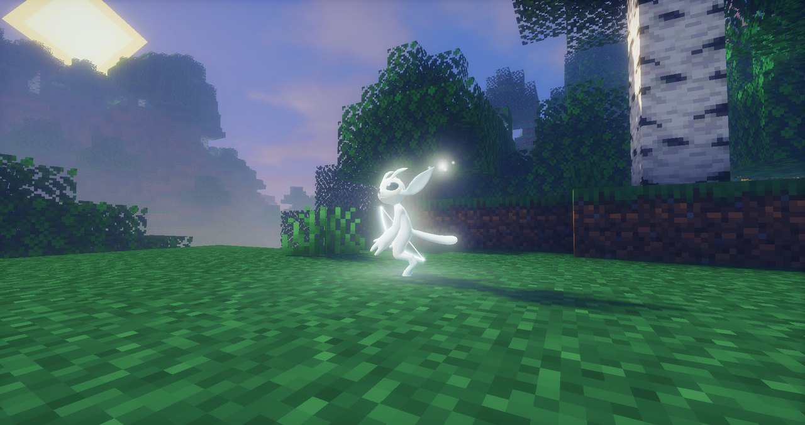
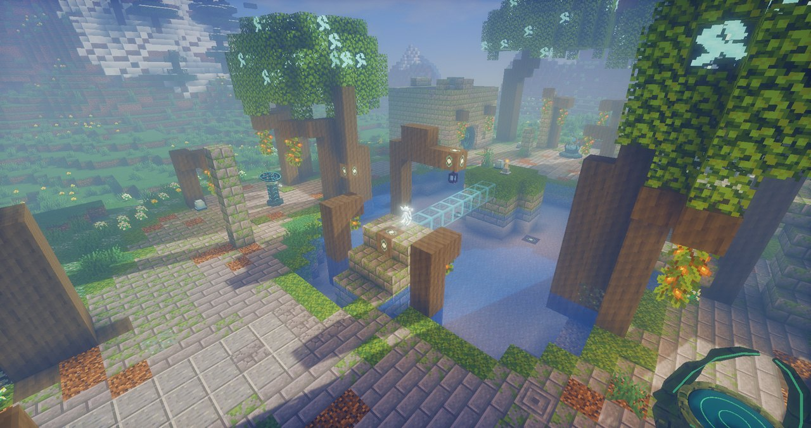
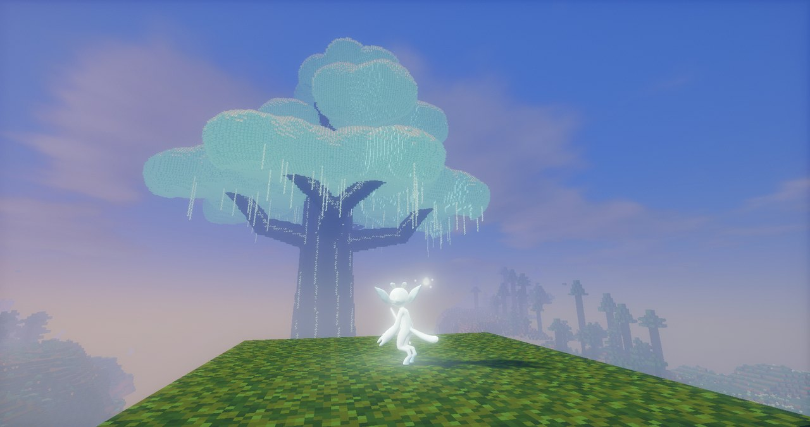
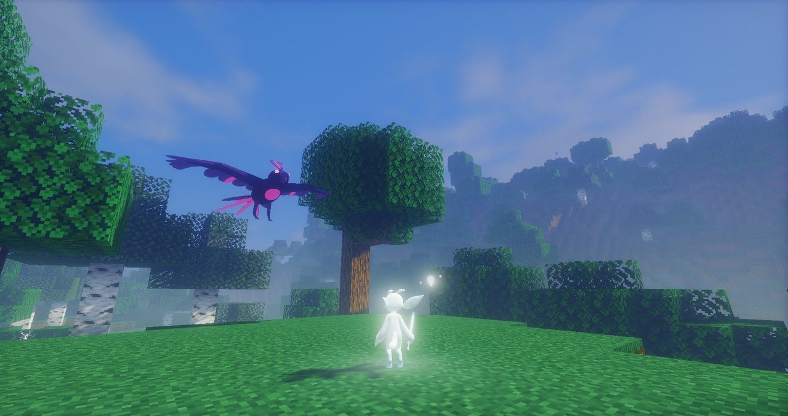
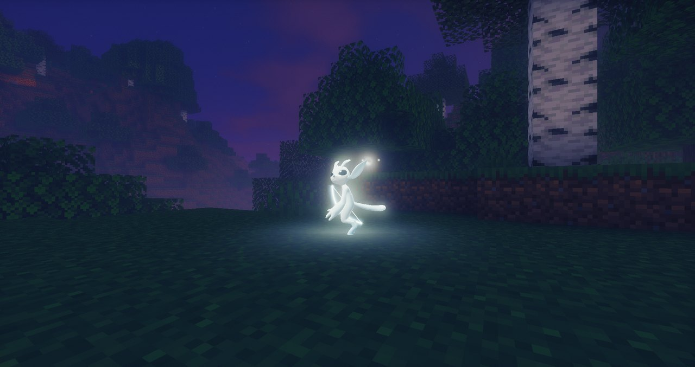

# Glimmerwood

> **非官方同人作品。** 本项目与 Microsoft、Xbox Game Studios、Moon Studios 无关，也未获其授权或认可。Ori 角色、名称及相关原作内容归各自权利人所有。
>
> NOT AN OFFICIAL MINECRAFT PRODUCT. NOT APPROVED BY OR ASSOCIATED WITH MOJANG OR MICROSOFT.

受《Ori》系列启发的 Minecraft 1.21.1 / NeoForge 模组（游戏内名称与模组 ID 暂为 OriMod / `orimod`）：变身精灵形态，用冲刺、猛击、滑翔等移动能力和灵光武器在原版生存世界里探索遗迹、净化腐化地带、挑战首领。

*An unofficial, non-commercial Ori-inspired NeoForge 1.21.1 mod: spirit form, movement abilities, light weapons, ruins and bosses in vanilla survival. Not affiliated with or endorsed by Microsoft, Xbox Game Studios or Moon Studios.*



## 内容

- **精灵形态**：使用精灵核心觉醒后可随时变身，拥有独立的角色模型、动画和第一人称手部。
- **移动能力**：冲刺、猛击、滑翔、牵引、下砸、攀爬、灵跃、水中冲刺等，逐步解锁。
- **战斗**：灵光刃、灵光弓、灵锤、灵矛，以及光爆、蓄力灵焰等能量技能。
- **成长**：灵光、生命格与能量格、技能面板。
- **世界**：森林泉、溪谷遗迹、洞穴祭台三类遗迹挑战，大灵树、金索树、腐化地带与腐光潮，林栖商人和地图石指引。
- **敌人与首领**：腐光喷吐者、腐光甲虫、腐光鸦、腐光翼母、腐光之心等。
- **自带光影 Spirit Glow**（需要 Iris，改编自 Mellow）。

| | |
| --- | --- |
|  |  |
| 森林泉遗迹 | 大灵树 |
|  |  |
| 首领：腐光翼母 | 黄昏 |

截图使用自带的 Spirit Glow 光影（Iris 1.8.12），实际画面取决于光影和显卡。

本模组面向**单人生存**；多人联机和专用服务器玩法尚未支持，见 [ADR-001](docs/ADR-001-SINGLE-PLAYER.md)。当前是 **0.0.1-alpha** 早期版本，存档格式和内容都可能变化；更新记录见 [CHANGELOG](CHANGELOG.md)，开发进展见 [WORK_STATUS](docs/WORK_STATUS.md)。

## 安装

1. 安装 Minecraft 1.21.1 和 NeoForge 21.1.248 或更高的 21.1.x：<https://neoforged.net/>，选择 “Install client”。
2. 用 NeoForge 配置启动一次游戏，生成 `mods/` 目录。
3. 把 OriMod 的 jar 放进 `mods/`。渲染库 [GemRender](https://github.com/Warfactory-Official/GemRender) 0.1.17 及其 Flywheel 1.0.6 已经内嵌（JarJar），不需要另装；许可与源码见 [THIRD_PARTY](THIRD_PARTY.md#gemrender)。
4. 推荐同时安装 Sodium 0.6.13 与 Iris 1.8.12。自带的 Spirit Glow 光影**默认关闭**：首次启动只提示一次，在“模组 → OriMod → 配置 → 画面”打开后才会复制到 Iris 的 `shaderpacks/` 并启用；关闭时恢复之前使用的光影。
5. 可直接打开已有存档；遗迹只在新探索的区块生成。

客户端设置在“模组 → OriMod → 配置”：特效画质、高级粒子、Spirit Glow 光影、镜头震动与屏幕闪光强度，保存在 `config/orimod-client.toml`。

### 创造模式与调试命令

- 创造模式物品栏有“OriMod 精灵”标签页，包含本模组全部物品：武器、灵核、生命格、能量格、钥石、地图碎片、遗迹方块（祭台、灵泉、钥石门、地图石、灵沙、腐光水、上升气流等），以及敌人和首领的刷怪蛋。
- `/orimod`（简写 `/ori`）需要权限等级 2：服务器管理员；单人世界需在创建时打开“允许作弊”，或者“对局域网开放 → 允许作弊”。每条命令都可以在末尾加 `<玩家>` 指定作用对象。

| 命令 | 作用 |
| --- | --- |
| `/ori awaken` | 觉醒（相当于使用灵核） |
| `/ori form on\|off\|toggle` | 切换精灵形态（没有觉醒时会自动觉醒） |
| `/ori unlock all` / `/ori unlock <能力>` | 解锁全部能力与碎片 / 单个能力（可 Tab 补全） |
| `/ori giveall` | 给予全部 OriMod 物品 |
| `/ori light <数量>` | 增加灵光 |
| `/ori energy fill` / `/ori energy set <n>` | 补满能量 / 设定能量 |
| `/ori cells life\|energy <0-10>` | 设定生命格 / 能量格数量 |
| `/ori locate forest_spring\|creek_ruins\|cave_altar` | 查找最近的遗迹（与原版 /locate 一样可以点击传送） |
| `/ori spawn spitter\|hawk\|heart\|matriarch\|target` | 在前方生成敌人、首领或练习靶 |
| `/ori god` | 开关无敌 |
| `/ori status` | 显示觉醒、形态、能力、灵光、能量、灵格 |
| `/ori reset` | 清空 OriMod 进度（能力、灵光、灵格，回到未觉醒） |

## 从源码构建

需要 Git、Git LFS、JDK 21。不要使用 GitHub 的源码 ZIP，它可能只含大文件指针。

```sh
git lfs install
git clone https://github.com/wwlWang/glimmerwood.git
cd glimmerwood
git lfs pull
./gradlew build --console=plain
```

Windows 使用 `gradlew.bat build --console=plain`；若遇到 Java loopback socket 错误，可运行 `./scripts/gradle.ps1 build --console=plain`。首次构建需要下载 Gradle、Minecraft 和 NeoForge 工具链。

锁定的 GemRender 和 Flywheel 保存在 `libs/`（LFS），构建前按 `dependencies/prepared.json` 校验，缺失或损坏时明确失败；GemRender 在打包时嵌入 OriMod jar。其余开发依赖按 `dependencies/lock.json` 从上游下载，不随仓库分发。

产物为 `build/libs/orimod-<版本>.jar`；可重现的发行 JAR 用 `scripts/build-release.sh` 生成（两次构建哈希一致，附 SHA256SUMS）。`./gradlew runPackagedClient -PquickPlayWorld=<存档名>` 只从 `run-packaged/mods/` 加载打好的 jar，按玩家安装方式检查。

推送到 `main` 后 GitHub Actions 自动构建并运行 JUnit；发版在 Actions 里手动运行 **Release**：先改 `mod_version` 并在 [CHANGELOG](CHANGELOG.md) 加对应小节，工作流会重新测试、做可重现构建、创建 GitHub Release，并可选上传 Modrinth（需要仓库 secret `MODRINTH_TOKEN` 与变量 `MODRINTH_PROJECT_ID`）。

## 开发与检查

| 项目 | 固定版本 |
| --- | --- |
| Minecraft | 1.21.1 |
| NeoForge | 21.1.248（构建与测试；运行时接受 `[21.1.248,21.2)`） |
| Java | 21 |
| Gradle Wrapper | 9.2.1 |
| ModDevGradle | 2.0.148 |
| Parchment | 1.21.1 / 2024.11.17 |
| 当前角色制作 | Blender 5.1.2；4.5.14 LTS 已完成兼容重导出数据对比，游戏内复查待完成 |

`runDevtoolsClient` 启动包含可选画面库与本地测试接口的实例；接口仅在显式开发启动中开启，发行 JAR 不含开发工具。操作和录制方法见 [DEVELOPMENT](docs/DEVELOPMENT.md)。

运行开发客户端前先用 Python 3 执行 `python scripts/sync-dependencies.py`，下载并核验可选依赖。该脚本适用于 Windows、Linux 和 macOS；原 PowerShell 脚本保留供本机重建渲染库使用。

`./gradlew test runGameTestServer` 运行规则与存档单元测试，以及独立的无界面服务端回归；Linux / macOS 可直接用 `scripts/check.sh` 一次完成 LFS 校验、构建、GameTest 和计数汇总。测试覆盖范围、最近一次全量结果与报告路径见 [TESTING](docs/TESTING.md)。真实客户端 Python 脚本继续用于输入同步和视觉验收；无界面测试不能替代这些检查。

客户端设置在“模组 → OriMod → 配置”：特效画质（流畅/均衡/精致）、高级粒子、镜头震动与屏幕闪光强度，保存在 `config/orimod-client.toml`，旧文件自动升级并保留原选择。

遗迹支持四向旋转，三种子共 225 次自然世界定位的 1500 格覆盖率均达到本轮 90% 目标。路线布局保存在 `src/main/resources/orimod/ruin_layout/`，属于随 JAR 发布的内部契约，不支持数据包覆盖；世界生成配置和群系标签仍使用原版数据包机制。

## 文件与恢复

- `src/`：模组与独立开发源码集。
- `art/source/`：角色、手部、怪物与建筑的 Blender 工程、导出物、生成参数与清单；大文件使用 LFS。
- `models/`：主角模型的下载原件和来源记录；未采用的候选不随仓库分发。
- `libs/`、`dependencies/`：构建所需的锁定依赖包与校验记录（许可见 [THIRD_PARTY](THIRD_PARTY.md)）。
- `docs/`：设计决定、计划、当前状态、审查修复和验收记录，索引见 [docs/README](docs/README.md)。
- `scripts/`：构建、资源生成、实机验证与发行脚本。

运行存档、原始录像、证据、历史资产候选、外部工具与 Minecraft 反编译源码不进入仓库。阶段标签只标记可恢复位置，不等于质量验收通过。

开发约定：所有改动直接提交到 `main` 并推送，不新建功能分支；协作时先同步主分支、保留其他人的改动，禁止强推覆盖。云端 Agent 接手请先读 [CLOUD_HANDOFF](docs/CLOUD_HANDOFF.md)；审查修复见 [AUDIT_FIXES](docs/AUDIT_FIXES.md)，验收结果见 [ACCEPTANCE_STATUS](docs/ACCEPTANCE_STATUS.md)。

## 许可与致谢

- 项目自身的代码与自制资源：[GPL-3.0-only](LICENSE)。
- 主角模型改编自 [Ori Rigged](https://sketchfab.com/3d-models/ori-rigged-d217801abaab4687b3aba56d5865e402)（作者 Random modeler / Seea_Rooster，[CC BY 4.0](https://creativecommons.org/licenses/by/4.0/)），改编后的模型、贴图与动画继续按 CC BY 4.0 提供。
- Spirit Glow 光影改编自 TheCMK 的 [Mellow](https://codeberg.org/TheCMK/mellow-shader)（MIT），不是 Mellow 官方版本，也未获作者背书。
- GemRender（GPL-3）、Flywheel（MIT）、NeoForge MDK 模板（MIT）等依赖的来源与许可见 [THIRD_PARTY](THIRD_PARTY.md)。
- 本项目不包含 Moon Studios 的原始贴图、模型、音乐或音效；声音使用原版 Minecraft 音效事件，其余资源为自制或程序生成。

问题和建议请提交 [Issue](https://github.com/wwlWang/glimmerwood/issues)。
