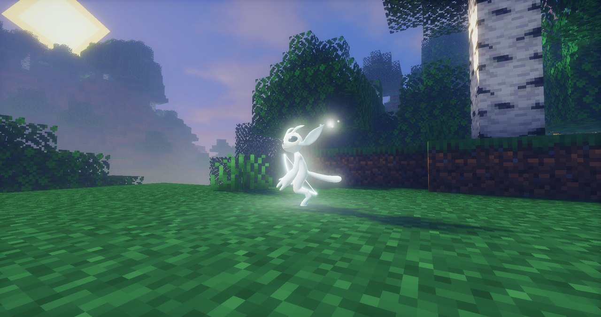

**[中文](#zh) · [English](#en)**

<h2 id="zh">中文</h2>

**Glimmerwood** 是受《Ori》系列启发的 Minecraft 1.21.1（NeoForge）冒险模组：使用精灵核心觉醒后变身精灵形态，用冲刺、猛击、滑翔等移动能力和灵光武器在原版生存世界里探索遗迹、净化腐化地带、挑战首领。

> **非官方同人作品。** 本项目与 Microsoft、Xbox Game Studios、Moon Studios 无关，也未获其授权或认可。Ori 及相关名称归各自权利人所有。模组不含原作素材：音效使用 Minecraft 原版声音事件，生物、方块和贴图均为自制或由脚本生成。

> **非常早期的 alpha 版本（0.0.1-alpha）。** 内容、平衡和存档格式都可能在版本之间变化，请备份存档。

### 内容

- **精灵形态**：独立的角色模型、动画和第一人称手部，以及生命格与能量格界面。
- **移动能力**：冲刺、猛击（借敌人和投射物弹射）、滑翔、牵引、下砸、攀爬、灵跃、水中冲刺，随进度解锁。
- **战斗**：灵光刃、灵光弓、灵锤、灵矛，以及光爆、蓄力灵焰等能量技能。
- **成长**：收集灵光、生命格与能量格，在技能面板解锁能力。
- **世界**：森林泉、溪谷遗迹、洞穴祭台三类遗迹挑战，大灵树、金索树、腐化地带与腐光潮，林栖商人和地图石指引。
- **敌人与首领**：腐光喷吐者、腐光甲虫、腐光鸦、腐光翼母、腐光之心。
- **可选光影 Spirit Glow**（需要 Iris）：改编自 TheCMK 的 Mellow，随模组附带，**默认关闭**；在“模组 → OriMod → 配置 → 画面”中打开。

### 安装

1. Minecraft **1.21.1**，NeoForge **21.1.248** 或更高的 21.1.x。
2. 把 Glimmerwood 的 jar 放进 `mods/` 即可：渲染库 GemRender（含 Flywheel）已经内嵌。
3. 推荐同时安装 Sodium 和 Iris，提升性能并可使用自带光影。

可直接打开已有存档，遗迹只在新探索的区块生成。游戏内模组名仍显示为 **OriMod**（模组 ID `orimod`）。

### 已知限制

- 面向单人游戏，暂不支持多人联机和专用服务器。
- 主要在 Linux 上测试；其他系统或显卡上遇到问题欢迎到 [Issues](https://github.com/wwlWang/glimmerwood/issues) 反馈。

### 致谢与许可

- 代码与原创素材：[GPL-3.0-only](https://github.com/wwlWang/glimmerwood/blob/main/LICENSE)，源码在 [GitHub](https://github.com/wwlWang/glimmerwood)。
- 角色模型改编自 Random modeler（Seea_Rooster）的 [Ori Rigged](https://sketchfab.com/3d-models/ori-rigged-d217801abaab4687b3aba56d5865e402)，[CC BY 4.0](https://creativecommons.org/licenses/by/4.0/)；改编后的模型、贴图和动画仍按 CC BY 4.0 授权。
- Spirit Glow 改编自 TheCMK 的 [Mellow](https://modrinth.com/shader/mellow)（MIT），不是 Mellow 官方版本，也未获 TheCMK 认可。
- 内嵌 [GemRender](https://github.com/Warfactory-Official/GemRender)（GPL-3）与 [Flywheel](https://github.com/Engine-Room/Flywheel)（MIT），详见 [THIRD_PARTY.md](https://github.com/wwlWang/glimmerwood/blob/main/THIRD_PARTY.md)。

---

<h2 id="en">English</h2>

**Glimmerwood** is an Ori-inspired adventure mod for Minecraft 1.21.1 (NeoForge). Awaken a Spirit Core, take on a glowing spirit form, and explore your survival world with fast, flowing movement and weapons of light.

> **Unofficial fan project.** Not affiliated with or endorsed by Microsoft, Xbox Game Studios or Moon Studios. Ori and related names belong to their respective owners. Glimmerwood contains no original game assets: sounds use vanilla Minecraft sound events, and creatures, blocks and textures are made from scratch or generated by scripts.

> **Very early alpha (0.0.1-alpha).** Content, balance and save data may change between versions. Back up your worlds.

### Features

- **Spirit form**: a fully animated spirit character with its own first-person paws, life and energy cell HUD.
- **Movement**: dash, Bash (launch off enemies and projectiles), glide, grapple, stomp, wall climb, Launch and water dash, unlocked as you progress.
- **Combat**: Spirit Blade, Spirit Bow, Spirit Hammer and Spirit Spear, plus energy skills such as Light Burst and Charge Flame.
- **Progression**: collect Spirit Light, life and energy cells, and unlock abilities in the skill panel.
- **Exploration**: three kinds of ruin challenges (forest springs, creek ruins, cave altars), a towering Great Spirit Tree, the Ginso Tree, blighted lands and gloom tides, a merchant outpost and map stones to guide you.
- **Enemies and bosses**: Gloom Spitters, Gloom Beetles, Gloom Hawks, the Gloom Matriarch and the Gloom Heart.
- **Optional Spirit Glow shader** (needs Iris): an adaptation of Mellow by TheCMK, bundled but **off by default**. Turn it on in *Mods → OriMod → Config → Visuals*.

### Installation

1. Minecraft **1.21.1** with **NeoForge 21.1.248** or any later 21.1.x.
2. Put the Glimmerwood jar in `mods/`. That's it: the rendering library GemRender (with Flywheel) is nested inside.
3. Recommended: Sodium and Iris for performance and the optional shader.

Works with existing worlds; ruins generate in newly explored chunks. In the game the mod is still listed as **OriMod** (mod id `orimod`).

### Known limitations

- Single-player focus. Multiplayer and dedicated servers are not supported yet.
- Tested mainly on Linux; please report issues with other systems and GPUs on [Issues](https://github.com/wwlWang/glimmerwood/issues).

### Credits and license

- Code and original assets: [GPL-3.0-only](https://github.com/wwlWang/glimmerwood/blob/main/LICENSE). Source: [GitHub](https://github.com/wwlWang/glimmerwood).
- Character model adapted from [Ori Rigged](https://sketchfab.com/3d-models/ori-rigged-d217801abaab4687b3aba56d5865e402) by Random modeler (Seea_Rooster), [CC BY 4.0](https://creativecommons.org/licenses/by/4.0/); the adapted model, textures and animations stay CC BY 4.0.
- Spirit Glow is adapted from [Mellow](https://modrinth.com/shader/mellow) by TheCMK (MIT). It is not an official Mellow release and is not endorsed by TheCMK.
- Nested [GemRender](https://github.com/Warfactory-Official/GemRender) (GPL-3) and [Flywheel](https://github.com/Engine-Room/Flywheel) (MIT). Full details in [THIRD_PARTY.md](https://github.com/wwlWang/glimmerwood/blob/main/THIRD_PARTY.md).

NOT AN OFFICIAL MINECRAFT PRODUCT. NOT APPROVED BY OR ASSOCIATED WITH MOJANG OR MICROSOFT.
